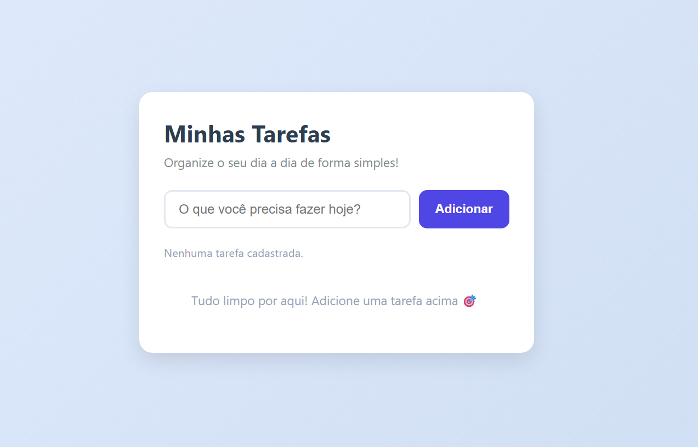
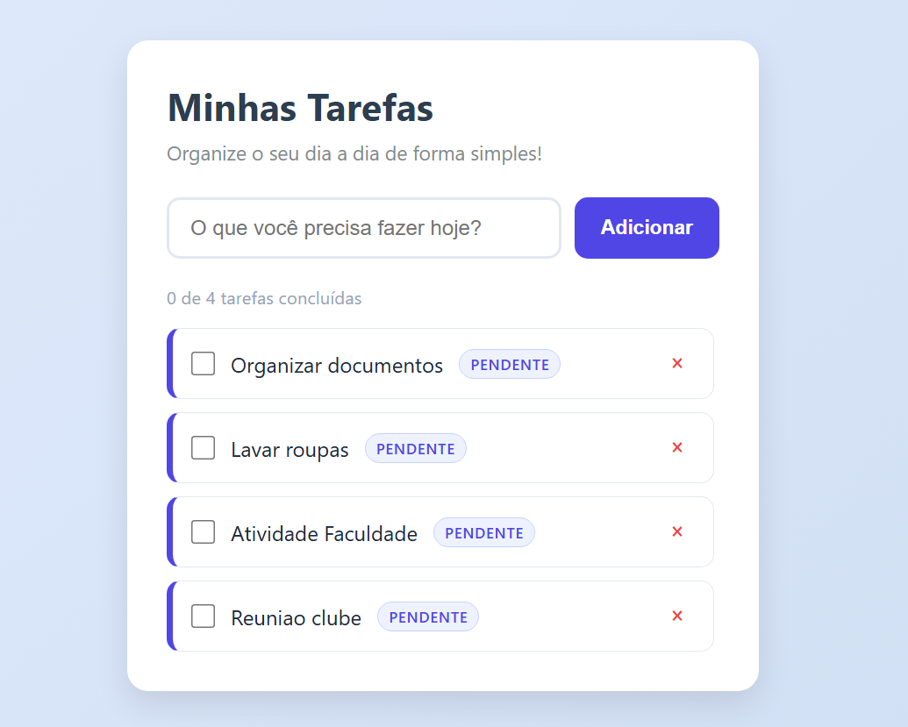
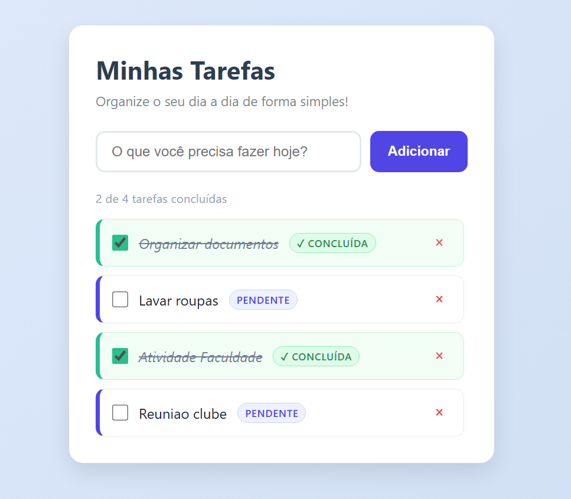
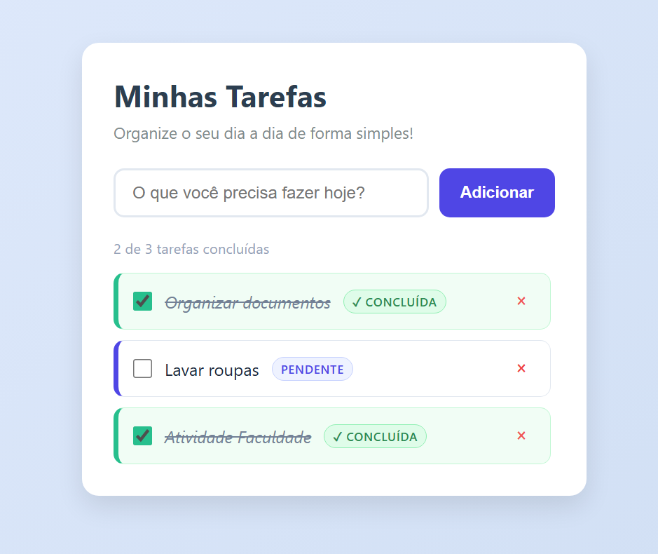
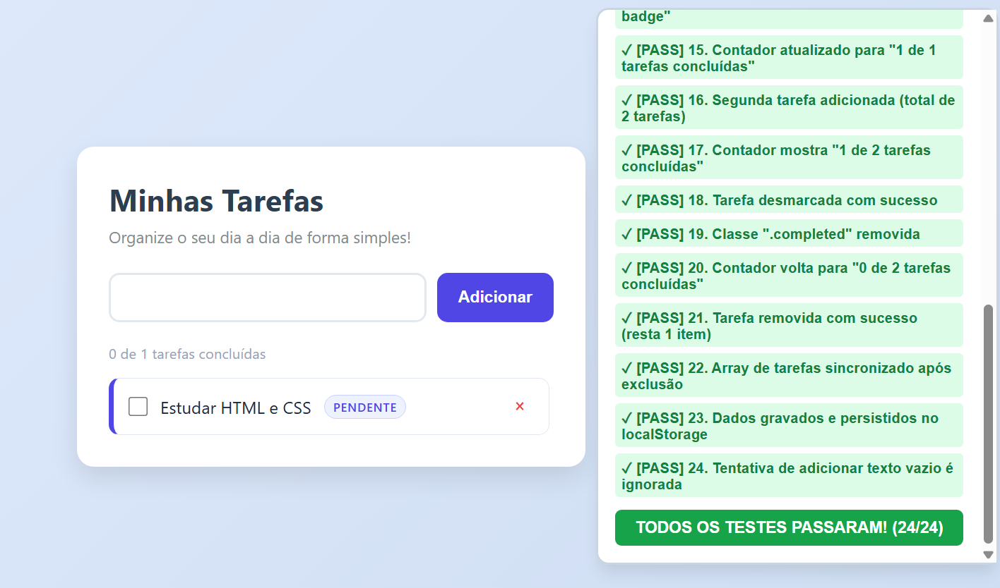

# ✅ Lista de Tarefas com o Google Antigravity

Projeto do **Desafio 3: Criando uma lista de tarefas com o Google Antigravity**. Aplicação web simples, com interface visual, para acompanhar atividades pendentes e concluídas. Foi desenvolvida com ajuda do Google Antigravity usando apenas **HTML, CSS e JavaScript**, sem frameworks e sem instalar nada.

## Funcionalidades

- **Adicionar tarefas:** digite uma atividade e clique em "Adicionar" (ou aperte Enter)
- **Marcar como concluída:** clique na caixinha de seleção ao lado da tarefa
- **Remover tarefas:** clique no **×** para excluir a atividade
- **Destaque visual:** tarefas pendentes e concluídas aparecem com aparências diferentes
- **Contador:** mostra quantas tarefas já foram concluídas
- **Lista vazia:** uma mensagem aparece quando não há tarefas
- **Dados salvos no navegador:** as tarefas continuam na lista mesmo depois de atualizar ou fechar a página

## Estrutura do projeto

```
lista-de-tarefas/
├── index.html         # Estrutura da página
├── style.css          # Visual da aplicação
├── script.js          # Comportamento e lógica
├── test-bundle.html   # Página de testes automatizados
├── README.md
└── imagens/           # Prints usados neste README
```

## Como executar

Não precisa de servidor nem de instalação:

1. Baixe os arquivos deste repositório e mantenha-os na mesma pasta
2. Dê um duplo clique no arquivo `index.html`
3. Ele abre no navegador (Chrome, Edge, Firefox...) pronto para usar

### Como rodar os testes

Dê um duplo clique em `test-bundle.html`. A página executa as verificações sozinha e mostra o resultado na tela.

## Exemplos de uso

**Tela inicial**



**Tarefas adicionadas**



**Tarefa concluída com visual diferente**



**Lista após remover uma tarefa**



## Como o código funciona

O projeto é dividido nos três pilares da web, cada um com uma responsabilidade:

### `index.html` — a estrutura

Define os elementos da página: o título (`<h1>`), o formulário (`<form>`) com o campo de texto (`<input>`) e o botão (`<button>`), e a lista (`<ul>`), que começa vazia. Também conecta o `style.css` no `<head>` e o `script.js` no final do `<body>`. Os `id`s, como `task-form` e `task-input`, servem como "etiquetas" para o JavaScript encontrar cada elemento.

### `style.css` — o visual

Cuida do design: centraliza o cartão na tela com `display: flex`, aplica cantos arredondados, sombra suave, fundo em degradê e a cor dos botões. Também define o efeito ao passar o mouse (`:hover`) e o estilo das tarefas concluídas, com a classe `.completed`.

### `script.js` — o comportamento

Escuta as ações do usuário e atualiza a tela sem recarregar a página:

| Função | O que faz |
|---|---|
| `addTask` | Adiciona uma nova tarefa à lista |
| `toggleTask` | Alterna a tarefa entre pendente e concluída |
| `deleteTask` | Remove a tarefa |
| `renderTasks` | Desenha na tela todos os itens da lista (cria os `<li>` dinamicamente) |
| `saveTasks` | Salva as tarefas no `localStorage` do navegador |

O `addEventListener('submit')` "vigia" o formulário e chama a `addTask` quando o usuário clica em "Adicionar" ou aperta Enter.

> As tarefas ficam salvas no navegador de quem está usando. Elas não são enviadas para nenhum servidor.

## Melhoria: destaque visual das tarefas concluídas

Depois da versão inicial, pedi ao Antigravity que deixasse as tarefas concluídas visualmente diferentes das pendentes. Apenas dois arquivos precisaram ser alterados. O `index.html` não mudou, porque as tarefas são criadas dinamicamente pelo JavaScript.

| | Pendente | Concluída |
|---|---|---|
| Fundo | Branco | Verde claro |
| Barra lateral | Roxa/índigo | Verde |
| Texto | Normal | Riscado, em itálico e acinzentado |
| Caixa de seleção | Padrão | Verde |
| Etiqueta | `PENDENTE` (azul) | `✓ CONCLUÍDA` (verde) |

**No `script.js`**, a função `renderTasks` passou a criar uma etiqueta que depende do estado da tarefa:

```javascript
const statusBadge = document.createElement('span');
statusBadge.className = `status-badge ${task.completed ? 'completed-badge' : 'pending-badge'}`;
statusBadge.textContent = task.completed ? '✓ Concluída' : 'Pendente';
contentDiv.appendChild(statusBadge);
```

**No `style.css`**, foram criadas as regras para cada estado:

```css
.task-item.completed {
  background-color: #f0fdf4;
  border-left: 5px solid #10b981;
}

.task-item.completed .task-text {
  text-decoration: line-through;
  color: #64748b;
  font-style: italic;
}
```

O JavaScript é quem sabe se a tarefa está concluída (`task.completed`), e o CSS decide como cada estado aparece.

## Testes

### Testes automatizados

Pedi ao Antigravity que verificasse se a lista de tarefas continua funcionando depois da melhoria. Ele criou a página `test-bundle.html`, que executa mais de 20 verificações automáticas sobre o comportamento da aplicação, como adicionar, concluir, desmarcar, remover e ignorar uma tarefa com texto vazio. No final, a página mostra um resumo com a quantidade de testes aprovados.

Para ler o resultado automaticamente, o Antigravity também abriu essa página no Chrome sem janela (modo *headless*) por um comando no PowerShell e extraiu os resultados do código da página.



### Testes manuais

Também testei manualmente no navegador:

| O que testei | Resultado |
|---|---|
| Adicionar uma tarefa | Aparece na lista como pendente |
| Marcar a caixinha | Fica verde, com texto riscado e etiqueta "Concluída" |
| Desmarcar a caixinha | Volta a ser pendente |
| Clicar no × | A tarefa é removida da lista |
| Atualizar a página | As tarefas continuam salvas |

## Prompts utilizados

1. *"Quero criar uma aplicação simples de lista de tarefas, com uma interface visual que permita adicionar, concluir e remover atividades. Estou começando a aprender desenvolvimento de software, então utilize tecnologias simples e organize o projeto de maneira que eu consiga compreender seus principais componentes. Use apenas HTML, CSS e JavaScript, em arquivos separados, sem frameworks nem instalação de nada."*
2. *"Explique o que cada arquivo faz (o HTML é a estrutura, o CSS é o visual e o JavaScript é o comportamento)."*
3. *"Quero que as tarefas concluídas apareçam visualmente diferentes das pendentes. Implemente essa melhoria e explique quais partes do código precisaram ser modificadas."*
4. *"Verifique se a lista de tarefas funciona: adicionar, concluir e remover tarefas, e se as tarefas concluídas aparecem diferentes das pendentes. Se precisar executar algo, faça de forma simples e me explique o resultado em linguagem fácil."*

## Tecnologias

- HTML5
- CSS3
- JavaScript (sem frameworks)
- Google Antigravity (geração, evolução e testes do código)
